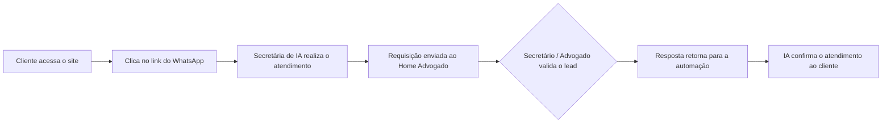

# ⚖️ JusIA -

> Atendimento automatizado e gestão de demandas para escritórios de advocacia, com agentes de IA e WhatsApp.


---

## Sobre o projeto

O **JusIA** é um sistema de atendimento automatizado ao cliente e gerenciamento de demandas para escritórios de advocacia. Uma **secretária virtual com IA** atende os clientes pelo **WhatsApp**, coleta as informações necessárias e envia a solicitação para a equipe do escritório, que acompanha, valida e aprova cada demanda por uma interface web.

Com isso, o escritório ganha agilidade no primeiro contato, organiza melhor a agenda e mantém os humanos no controle das decisões importantes: nada é confirmado ao cliente sem passar pela validação da equipe.

## Funcionalidades

- **Atendimento via WhatsApp** conduzido por um agente de IA (secretária virtual)
- **Captação e qualificação de leads** com envio automático para validação
- **Validação de leads** por secretários e advogados
- **Agenda de horários marcados** com atualização de calendário
- **Confirmação do atendimento** ao cliente pelo WhatsApp após a aprovação
- **Cadastro de secretários** pelo advogado
- **Controle de acesso por perfil** (cliente, secretário, advogado e administrador)

## Fluxo de funcionamento



## Perfis de usuário

| Perfil | Descrição |
|---|---|
| **Cliente** | Acessa o site, clica no link que o redireciona ao WhatsApp oficial da empresa e é atendido pela secretária de IA. |
| **Secretário** | Recebe e valida o lead do cliente, retornando a informação para a automação. Também pode consultar os horários marcados. |
| **Advogado** | Acessa os horários marcados, valida leads e cadastra secretários. |
| **Administrador** | Acesso total ao sistema. |

## Interfaces

O protótipo das telas está disponível no Gloomaps: [ver protótipo](https://www.gloomaps.com/94VqE1sTXK)

| Interface | Descrição |
|---|---|
| **Home Cliente** | Direciona o cliente para o WhatsApp, onde ocorre o atendimento. |
| **Home Advogado** | Validação de leads, atualização do calendário com horários e envio de resposta ao cliente. |
| **WhatsApp** | Agente de IA que realiza o atendimento, envia a requisição de serviço para o Home Advogado e confirma o atendimento ao cliente. |

## Identidade visual

Paleta de cores planejada, em tons terrosos que transmitem sobriedade e confiança:

| Cor | Hex |
|---|---|
| Marrom escuro | `#5E3023` |
| Marrom profundo | `#4A2115` |
| Caramelo | `#C08552` |
| Marrom dourado | `#935F32` |
| Off-white | `#F5F4E6` |

## Tecnologias

- **Front-end:** _a definir_
- **Back-end:** _a definir_
- **Banco de dados:** _a definir_
- **Automação / Agentes de IA:** _a definir_
- **Integração WhatsApp:** _a definir_

### Variáveis de ambiente

```env
# Exemplo (ajuste conforme o projeto)
WHATSAPP_API_TOKEN=
AI_API_KEY=
DATABASE_URL=
```

## 🗺️ Roadmap

- [ ] Home Cliente com redirecionamento para o WhatsApp
- [ ] Agente de IA para atendimento e coleta de informações
- [ ] Envio de requisições para o Home Advogado
- [ ] Validação de leads (secretário e advogado)
- [ ] Calendário de horários marcados
- [ ] Confirmação automática ao cliente via WhatsApp
- [ ] Cadastro de secretários
- [ ] Controle de acesso por perfil
- [ ] Painel do administrador

## Licença

Licença a definir. Veja o arquivo `LICENSE` quando disponível.

## Autores

Desenvolvido por **Henrique e Lorenzo**.
